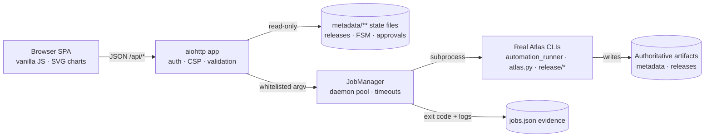

# Atlas Mission Control

**A browser-based operations control plane for the Atlas governed data pipeline.**

Observe real pipeline state, trigger governed operations, watch execution live —
from any device on your tailnet. Every button runs the *real* Atlas CLI; every
number is read from *authoritative state files*. Nothing is simulated, nothing
is fabricated.

```text
┌──────────────┬──────────────────────────────────────────────────┐
│  ATLAS       │  Overview                    ⌘K Search   ● auth  │
│  Mission     │  atlas-dataset · governed AI data infrastructure  │
│  Control     ├──────────────────────────────────────────────────┤
│              │                                                  │
│  ◇ Overview  │   Latest release    Readiness     Pipelines      │
│  ≡ Guide     │   v1.0 · 9.5M       BLOCKED      0 active        │
│  ⇄ Pipelines │                                                  │
│  ✓ Review    │   ┌ INGESTED ─▶ QUALITY ─▶ PROVENANCE ─▶ … ┐     │
│  ▤ Sources   │   └ FSM node graph · current state glowing ┘     │
│  ▦ Views     │                                                  │
│  ➤ Releases  │   [ Run dry-run ]  [ Verify chain ]  [ ⌘K more ] │
│  ∥ Eval      │                                                  │
│  🛡 Readiness│                                                  │
│  ▣ Jobs      │                                                  │
└──────────────┴──────────────────────────────────────────────────┘
```

---

## Why this exists

Atlas operations were previously reachable only through CLI entry points
(`automation_runner`, `atlas.py`, `scripts/release/*`) and a terminal TUI.
Mission Control puts the same governed operations behind a browser window —
**without duplicating a single line of business logic**:

| Principle | Implementation |
|---|---|
| Existing CLI is authoritative | Every action is a fixed argv template over the real CLIs |
| No second source of truth | Reads aggregate `metadata/**` state files; writes happen only through the automation layer |
| Jobs are evidence, not truth | Each trigger persists argv, exit code and full logs under `metadata/dashboard/` |
| Fail loudly | Missing state renders as explicit `_missing`; AI-reviewer exit code 3 becomes `needs_attention`, never acceptance |

Full design rationale lives in [ADR-016](../../../docs/adr/ADR-016-engineering-dashboard.md).

---

## Quick start

```bash
# from the repository root — no build step, no extra dependencies
python -m scripts.dashboard.server --port 8765

# open http://127.0.0.1:8765
```

That is the entire install. The stack is Python **aiohttp** (already pinned in
`requirements-lock.txt`) serving a vanilla-JS single-page frontend from
`scripts/dashboard/static/`.

### Production-ish setup (systemd + Tailscale)

```bash
# persistent service bound to loopback with bearer token
systemctl --user enable --now atlas-dashboard

# publish HTTPS to your tailnet only
tailscale serve --bg 8765
# → https://<host>.<tailnet>.ts.net
```

---

## What you can do here

| Tab | What it shows | What you can trigger |
|---|---|---|
| **Overview** | Latest release, readiness verdict, gate mix donut, records-by-category chart, job-duration sparkline | Self-test, architecture validation, readiness recompute, chain verify |
| **Guide** | First-run tour, 5-minute quick start, vocabulary, end-to-end recipes, safety rules | One-click recipe actions |
| **Pipelines** | Interactive 11-state FSM graph per pipeline, transition timeline, approval state | run/dry-run, retry, resume, request approval, approve, deny, release, cancel |
| **Review** | Review cohort progress, queue counts, SFT review batches, artifact browser | Generate samples, AI review, human↔AI calibration, quality calibration |
| **Sources & ETL** | Source registry, download cache stats, ETL outputs per source | Acquisition dry-run/execute, downloads, ETL |
| **Training Views** | View packages with observed file counts, placeholders | Build views, transform, e2e |
| **Releases** | Hash-linked chain visualization, manifest details, bundle file listing | Verify bundle/chain, checksums, promote, HF publish/restore |
| **Evaluation** | Benchmark registry (internal + external), evaluation reports | Describe/dry-run/execute benchmarks, AQL queries |
| **Readiness** | Six-gate verdict cards with report hash integrity | Recompute readiness |
| **Jobs** | Full operator-triggered history: status, exit codes, durations, searchable logs | Cancel running jobs |

---

## How it works



1. **Reads** (`GET /api/*`) aggregate authoritative files. Nothing is computed
   client-side beyond presentation.
2. **Actions** (`POST /api/actions/{id}/run`) validate parameters against a
   server-side schema, then enqueue a job.
3. **Jobs execute the real CLIs** as subprocesses in their own session, with a
   hard timeout, SIGTERM→SIGKILL escalation, and captured stdout.
4. **Job records persist** so every operation has auditable evidence — what ran,
   when, with which arguments, and what came out.

---

## Safety model

Every action carries an explicit danger level, surfaced as button color and
modal warnings:

| Level | Meaning | Examples | Guardrail |
|---|---|---|---|
| `read` | Zero side effects | self-test, verify chain, cache stats, dry-runs | — |
| `safe_write` | Creates new artifacts in approved locations | build views, bundles, checksums | Write-root enforcement (`atlas_paths.is_write_safe`) |
| `network` | Performs external I/O | downloads, HF publish/restore, AI reviewer | Disabled with reason when credentials absent |
| `destructive` | Changes governance state | approve, deny, cancel, promote, release | Requires typing the exact confirmation phrase |

Additional guarantees:

- Human approval flows through the unchanged automation layer — the browser
  user **is** the human approver, identified by name and role.
- `VALIDATION → RELEASED` remains forbidden by the FSM; the dashboard cannot
  bypass it because it never touches state directly.
- Credential-gated buttons disable themselves with the reason shown
  (`missing environment: HF_TOKEN`). Secret values never cross the API boundary —
  presence booleans only.
- File-path parameters resolve inside whitelisted read subtrees; traversal and
  absolute paths are rejected.
- Optional bearer token (`ATLAS_DASHBOARD_TOKEN`) gates every `/api` call with
  constant-time comparison.

---

## Command palette & shortcuts

| Input | Effect |
|---|---|
| <kbd>⌘K</kbd> / <kbd>Ctrl+K</kbd> | Open command palette anywhere |
| type… | Fuzzy-filter across all 43 actions, sections and pipelines |
| <kbd>↑</kbd><kbd>↓</kbd> + <kbd>↵</kbd> | Select and open the action form |
| <kbd>esc</kbd> | Close palette / modal / drawer |

New to the system? The **Guide** tab contains a five-minute quick start, a
glossary, two complete workflows (data-in→views and release flow), a
job-status decoder, and a troubleshooting table.

---

## Configuration

| Environment variable | Default | Purpose |
|---|---|---|
| `ATLAS_DASHBOARD_TOKEN` | *(unset = no auth)* | Bearer token required on `/api/*` |
| `ATLAS_WORKERS_DASHBOARD` | auto (ADR-013) | Job-pool worker slots (clamped 1–4) |
| `--host` / `--port` | `127.0.0.1:8765` | Bind address; keep loopback and publish via `tailscale serve` |

Remote access pattern (recommended): bind loopback, then
`tailscale serve --bg 8765` → tailnet-only HTTPS with automatic certificates.
No LAN exposure, no funnel, revocable with one command.

---

## API sketch

All endpoints JSON unless noted. Auth: `Authorization: Bearer $TOKEN` on
everything except `/api/health`.

```text
GET  /api/health                  liveness + active-job count
GET  /api/overview                aggregated system snapshot
GET  /api/catalog                 action registry incl. enabled/disabled reasons
GET  /api/releases[/{version}]    release index / single manifest + bundle listing
GET  /api/pipelines[/{id}]        FSM states + approval requests
GET  /api/review/{progress,queue,artifacts,sft}
GET  /api/sources[/etl|/downloads|/cache]
GET  /api/views                   view packages + observed record counts
GET  /api/evaluation/{benchmarks,reports}
GET  /api/intelligence            difficulty classification summaries
GET  /api/calibration             baseline v0.1 + latest quality report
GET  /api/readiness               six-gate training verdict
GET  /api/jobs[/{id}][/log]       job evidence (+ parsed CLI decision)
POST /api/jobs/{id}/cancel        graceful cancellation
POST /api/actions/{id}/run        enqueue an action (validated params)
GET  /api/preview?path=…          whitelisted read-only file preview
```

Unknown parameters are rejected outright; destructive actions additionally
require `confirm` to equal their published phrase.

---

## Testing

```bash
# 46 integration/unit tests: catalog safety, param validation, destructive
# confirmation, path traversal rejection, auth middleware, job lifecycle
# (success/failure/attention/cancel/persistence), SPA wiring regression guard
python -m pytest tests/test_dashboard_server.py -q

# governance
python scripts/validate_architecture.py     # PASS — dashboard registered Layer 4
```

The suite includes a deliberate regression guard asserting the modal submit
wiring exists in the served HTML/JS — the class of bug that leaves buttons dead
while every API test stays green.

---

## Project layout

```text
scripts/dashboard/
├── app.py          aiohttp assembly: routes, auth/CSP/error middleware
├── actions.py      43-action whitelist; argv builders over real CLIs
├── jobs.py         persisted daemon-pool runner; timeout/cancel/recovery
├── state.py        read-only aggregation of authoritative state
├── safety.py       path whitelists, confirmations, token compare
├── server.py       entrypoint: python -m scripts.dashboard.server
└── static/
    ├── index.html  shell: sidebar, palette, modals, drawer, welcome tour
    ├── style.css   design tokens → components (dark ops-console theme)
    ├── app.js      control plane: tabs, renderers, palette, onboarding
    └── viz.js      dependency-free SVG: sparklines, donuts, bars, FSM graph
```

## Design principles

1. **Orchestration only** — if logic starts appearing here, it belongs in a
   lower layer instead.
2. **Evidence over assumption** — a green checkmark means an exit code was 0;
   refusals surface verbatim as *"CLI decision"* messages.
3. **Teach while operating** — danger colors, disabled-with-reason buttons and
   the Guide tab make the governance model visible rather than magical.
4. **Boring stack** — aiohttp + vanilla JS + inline SVG. Clone-and-run must
   always work offline-first.

---

*Maintained under [ADR-016](../../../docs/adr/ADR-016-engineering-dashboard.md).
Part of the Atlas governed AI data infrastructure.*
